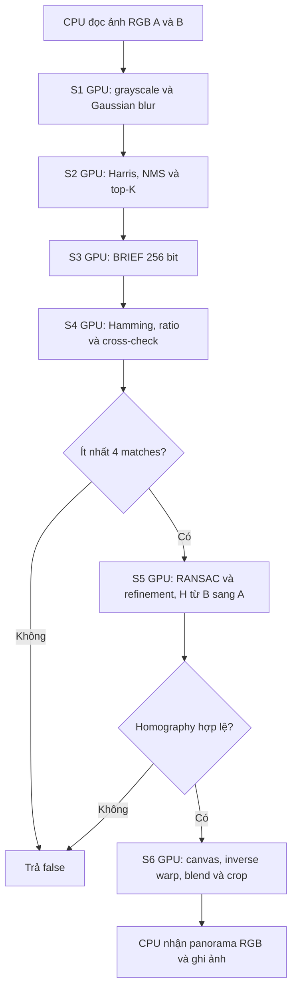

# V1 pipeline — Basic CUDA S1–S6

## 1. Phạm vi và nguyên tắc

V1 thực hiện mọi phép tính của S1–S6 trên GPU bằng kernel cơ bản, theo
[PLAN.md](../PLAN.md). CPU đọc/ghi ảnh, kiểm tra metadata bộ đệm, cấp phát/giải phóng
bộ nhớ, copy dữ liệu, launch kernel và thu thập thời gian. CPU không chọn keypoint,
không sinh mẫu RANSAC, không giải homography và không tính canvas thay GPU.

Các wrapper vẫn nhận/trả `std::vector` trên host. Copy dữ liệu trung gian về host
rồi đưa lên GPU cho stage kế tiếp được phép ở V1; giữ dữ liệu liên tục trên device
là phạm vi V5. Không có CPU fallback khi CUDA thất bại.

Đây là bản song song cơ bản, chưa dùng descriptor tiling, texture sampling hay
warp/hypothesis của các version tối ưu. Một vài bước nhỏ hoặc có phụ thuộc thứ tự
dùng một thread GPU; phần xử lý pixel, keypoint, query và giả thuyết được chia song song.

## 2. Các file và interface

| File | Vai trò |
|---|---|
| [cuda_pipeline.cu](../../src/cuda/cuda_pipeline.cu) | `run_v1`, thứ tự S1–S6, profiler và xử lý lỗi |
| [v1_stages.h](../../src/core_headers/v1_stages.h) | Khai báo interface công khai của các stage |
| [v1_stage12.cu](../../src/stage_implementations/v1_stage12.cu) | Grayscale, Gaussian weights/blur, Harris, NMS, top-K |
| [v1_stage34.cu](../../src/stage_implementations/v1_stage34.cu) | BRIEF, matching, ratio/cross-check và compaction |
| [v1_stage5.cu](../../src/stage_implementations/v1_stage5.cu) | Sinh mẫu, normalized DLT, RANSAC, scoring và refinement |
| [v1_stage6.cu](../../src/stage_implementations/v1_stage6.cu) | Ma trận/canvas, inverse warp, bilinear, feather, mask và crop |
| [cuda_utils.cuh](../../src/core_headers/cuda_utils.cuh) | RAII buffer, kiểm tra CUDA, launch/copy và CUDA-event timing |
| [common.h](../../src/core_headers/common.h) | Kiểu dữ liệu, tham số và `StageTimes` dùng chung |

Helper thuật toán riêng của S5 và S6 nằm ngay trong file `.cu` tương ứng, không
tách ra `stage5_math.h`, `stage5_sampling.h` hoặc `stage6_crop.h`. Header chung chỉ
chứa kiểu dữ liệu, interface và tiện ích CUDA.

## 3. Luồng tổng thể

Mỗi wrapper: cấp phát device buffers → H2D input → chạy các kernel theo thứ tự
trên default stream → D2H output → giải phóng device buffers. Các wrapper đồng bộ
trước khi trả về, nên stage sau luôn nhận dữ liệu hoàn chỉnh. S1–S3 chạy cho cả A
và B; S4–S6 xử lý quan hệ giữa hai ảnh.

`run_v1` kiểm tra metadata ảnh, gọi lần lượt các wrapper và ghi số lượng
keypoint/match/inlier. Nếu `collect_debug=true`, kết quả keypoint và match đã có
trên host được giữ để xuất artifact; thao tác này không tính lại thuật toán stage.

## 4. S1 — Grayscale và Gaussian blur

### Input và output

- Input: `Image` RGB interleaved, ba byte mỗi pixel.
- Output giữa hai bước: `Gray` float; output cuối S1: ảnh grayscale đã blur.
- Thực hiện độc lập cho A và B.

### Các kernel

1. `rgb_to_gray_kernel`: mỗi thread xử lý một pixel, tính
   `0.299f * R + 0.587f * G + 0.114f * B`, giữ công thức V0.
2. `gaussian_weights_kernel`: một thread GPU tạo chín hệ số với `sigma=1.4`,
   bán kính 4, cộng tổng rồi chuẩn hóa. Hệ số nằm trong global-memory buffer.
3. `gaussian_blur_kernel<true>`: mỗi thread tạo một pixel của horizontal pass.
4. `gaussian_blur_kernel<false>`: mỗi thread tạo một pixel của vertical pass.

Blur vẫn separable; tọa độ vượt biên được clamp như V0. Không fuse kernel và
không dùng shared-memory tile/halo của V4. CPU chỉ tạo buffer và launch; không
còn gọi `std::exp` để tạo hệ số Gaussian.

Wrapper grayscale trả ảnh về host; wrapper blur copy ảnh đó lên lại GPU. Đây là
chi phí baseline được ghi trong H2D/D2H và end-to-end.

## 5. S2 — Harris, NMS và top-K

### Harris response

`tensor_kernel` chia một pixel/thread, tính Sobel `Ix`, `Iy` với hệ số `1/8`, rồi
ghi `Ixx`, `Iyy`, `Ixy`. `harris_response_kernel` tiếp tục một pixel/thread,
cộng cửa sổ 5×5 và tính `det(M) - 0.04 * trace(M)^2`.

Các quy tắc clamp, bán kính cửa sổ và thứ tự tích lũy bám V0.

### Threshold và NMS

1. `max_response_kernel` chạy hai lượt reduction trên GPU để lấy response lớn
   nhất. Giá trị ban đầu là 0 như V0, kể cả khi mọi response đều âm.
2. `nms_kernel` xử lý một pixel/thread, bỏ border 16 pixel và response không vượt
   `0.01 * max_response`, rồi kiểm tra lân cận 5×5.
3. Khi response bằng nhau, điểm có raster index nhỏ hơn thắng. Điểm giữ lại được
   ghi bằng `atomicAdd` vào mảng ứng viên; thứ tự ghi ban đầu có thể thay đổi.

### Top-K deterministic trên GPU

`merge_candidates_kernel` sắp xếp ứng viên bằng merge sort global memory. Ở mỗi
lượt, các run có độ dài `1, 2, 4, ...` được ghép. Mỗi thread xử lý một ứng viên,
tìm vị trí của nó trong run bên kia bằng binary search rồi ghi đúng vị trí vào
scratch buffer. Hai device buffer đổi vai trò giữa các lượt.

Thứ tự cuối: **score giảm dần → y tăng dần → x tăng dần**, giống V0. Vì vậy thứ
tự `atomicAdd` không ảnh hưởng kết quả. Sau khi GPU sắp xếp, chỉ copy tối đa
`kTopK=3000` phần tử đầu về host. CPU dùng candidate count để chọn kích thước
buffer/copy và số lượt launch, không so sánh score hay sắp xếp keypoints.

Không còn `std::sort` hoặc `std::partial_sort` trên CPU trong V1.

## 6. S3 — BRIEF descriptor

Input là ảnh blurred và danh sách keypoint đã sắp thứ tự; output là một
`Descriptor` gồm bốn word 64 bit, tổng cộng 256 bit cho mỗi keypoint.

`describe_kernel` chia một keypoint/thread. Mỗi thread tự sinh lại pattern BRIEF
bằng cùng xorshift seed `12345`, đọc cặp pixel trong patch 31×31 và đặt bit theo
kết quả so sánh. Offset và pixel sampling được clamp theo V0; phần lẻ tọa độ
keypoint được xử lý theo cùng cách chuyển sang số nguyên.

Keypoint không hữu hạn hoặc ngoài ảnh đặt cờ lỗi trên GPU. Wrapper đọc cờ để trả
output rỗng khi input không hợp lệ. CPU không tạo pattern và không tính descriptor.

## 7. S4 — Matching

1. `nearest_kernel` chạy A→B: mỗi thread phụ trách một query descriptor A,
   duyệt các descriptor B và tìm best/second-best Hamming distance.
2. Chạy lại kernel B→A để lấy best reverse match.
3. `filter_kernel`: một query/thread, áp dụng strict ratio test `best < 0.8 * second`
   và mutual cross-check. Nếu không có second-best, query bị loại như V0.
4. `compact_kernel`: một thread GPU quét các cờ giữ lại theo `idxA` tăng dần và
   ghi matches liên tiếp, bảo toàn thứ tự V0.

Hamming distance là tổng `__popcll(a.bits[k] ^ b.bits[k])` của bốn word. Duyệt
candidate theo index tăng dần và chỉ cập nhật khi khoảng cách nhỏ hơn để giữ
tie-break của V0. Đây là baseline global memory, chưa có tiling của V2 hoặc
warp/query của V6. CPU chỉ nhận match count rồi cấp phát/copy mảng matches.

## 8. S5 — RANSAC homography và refinement

### Interface và quy ước

`v1_ransac_homography(kpA, kpB, matches, H, nInliers)` trả `bool`.
Homography **H ánh xạ B → A**: `src=kpB[idxB]`, `dst=kpA[idxA]`. S6 cần đúng
quy ước này để inverse warp panorama về ảnh B.

Giữ `kRansacIters=2000`, threshold 3 pixel, seed `2026`, mẫu gồm bốn match khác
index và refinement theo V0. Không có early stopping hay warp/hypothesis ở V1.

### 8.1. Lọc và chuẩn bị cặp điểm

`validate_matches_kernel`: một match/thread, kiểm tra hai index và tọa độ hữu hạn.
`compact_points_kernel`: một thread GPU gom matches hợp lệ theo thứ tự đầu vào,
tạo mảng `src`, `dst` và số lượng hợp lệ. Giữ thứ tự là điều kiện để mẫu index
RANSAC chỉ đúng cùng cặp điểm như V0. Nếu dưới bốn cặp hợp lệ, không tạo mô hình.

### 8.2. Sinh mẫu trên GPU

`generate_samples_kernel` dùng một thread GPU để duy trì chuỗi MT19937 liên tục
qua 2.000 lượt, bao gồm cả lần bốc bị loại do trùng index trong mẫu. Toàn bộ dãy
8.000 index được lưu trên device trước khi chấm giả thuyết song song.

V0 dùng `std::mt19937` và `std::uniform_int_distribution<int>`. Seed giống nhau
chưa đảm bảo dãy mẫu giống nhau nếu đổi implementation của distribution. V1
tái tạo downscaling của **libstdc++**: đường legacy với GCC ≤10, đường multiply/
rejection với GCC ≥11. Build V0 và V1 bằng cùng nvcc + GCC/libstdc++, như Colab.
STL khác chưa được hỗ trợ và bị báo lỗi build rõ ràng; không âm thầm đổi dãy mẫu.
Test S5 kiểm tra trực tiếp các sample GPU với distribution của toolchain V0.

### 8.3. Tạo và chấm giả thuyết

`score_hypotheses_kernel` dùng block 64 thread, **một thread/giả thuyết**.
Mỗi thread:

1. Đọc bốn sample index của mình.
2. Chuẩn hóa tập source/destination riêng: trừ tâm và scale theo mean distance.
3. Lập normal equations của normalized DLT tám tham số với `h[8]=1`.
4. Giải hệ 8×8 bằng pivoting, giải chuẩn hóa H và kiểm tra giá trị hữu hạn.
5. Duyệt tuần tự các matches, tính squared reprojection error; error ≤9 là inlier.
6. Ghi H, số inlier và tổng lỗi của inlier vào candidate của mình.

Các giả thuyết chạy song song, vòng lặp chấm match trong từng thread vẫn tuần tự.
Dùng `double` và fixed-size arrays; không dùng `std::vector` hoặc cấp phát động
trong kernel. Giả thuyết suy biến nhận count `-1` và bị bỏ khi chọn best.

### 8.4. Chọn best, refinement và đếm lại

`refine_best_kernel` dùng một thread GPU để giữ thứ tự deterministic:

- Ưu tiên nhiều inlier hơn.
- Nếu bằng nhau, ưu tiên tổng reprojection error nhỏ hơn.
- Nếu vẫn bằng nhau, giữ iteration xuất hiện trước như V0.

Kernel gom lại index inlier của best H theo thứ tự match, giải normalized DLT
trên **toàn bộ tập inlier** để refinement, rồi chấm lại tất cả matches bằng H
đã refine. `nInliers` là consensus của H cuối, không phải count của giả thuyết cũ.
Chỉ thành công khi refinement hợp lệ và có ít nhất bốn inlier cuối.

Wrapper copy một `Result` chứa H/count/status về host. CPU không chọn best,
không refine và không đếm inlier. CUDA errors ném exception; không gọi S5 V0.

## 9. S6 — Canvas, warp, blend và crop

### 9.1. Chuẩn bị ma trận và canvas trên GPU

`prepare_canvas_kernel` chạy một thread GPU, gọi `make_canvas` để:

1. Kiểm tra H hữu hạn, chuẩn hóa theo hệ số có trị tuyệt đối lớn nhất.
2. Tính adjugate làm phép chiếu ngược A→B và kiểm tra determinant. Vì tọa độ
   projective chia cho z, không cần chia adjugate cho determinant để sampling.
3. Chiếu bốn góc B sang A; loại phép biến đổi có horizon cắt qua ảnh.
4. Snap tọa độ gần số nguyên, tính min/max hợp với bounds A, floor/ceil và tính
   origin/kích thước canvas.
5. Kiểm tra giới hạn cạnh 32.768 và tổng 64×1024×1024 pixel.

CPU nhận `CanvasConfig` để cấp phát buffers và tạo grid launch. Ma trận và bounds
đã được GPU tính; CPU chỉ dùng lại metadata này, kể cả truyền H ngược vào kernel.

### 9.2. Inverse warp và feather blend

`warp_blend_kernel`: mỗi thread tạo một pixel canvas, ánh xạ vị trí về hệ A rồi
dùng inverse H để tìm tọa độ B. Nếu pixel thuộc B, clamp trong tolerance và nội
suy bilinear thủ công bằng bốn pixel nguồn. Giữ `double`, quy tắc biên và làm
tròn màu như V0, chưa dùng texture cache/hardware interpolation của V3.

Nếu pixel thuộc cả hai ảnh, trọng số feather dựa trên khoảng cách tới biên của
từng ảnh; khi tổng khoảng cách bằng 0, dùng 0.5/0.5. Kernel ghi RGB và valid mask.
Mask dựa vào tọa độ hợp lệ, không dựa vào màu, nên vùng ảnh đen vẫn được giữ.

### 9.3. Tìm vùng crop trên GPU

- `build_crop_histograms_kernel`: mỗi thread phụ trách một cột, quét từ trên
  xuống để tính chiều cao chuỗi valid liên tiếp tại từng pixel.
- `find_crop_rows_kernel`: mỗi thread phụ trách một hàng, dùng stack riêng trên
  global memory tìm hình chữ nhật valid lớn nhất kết thúc ở hàng đó.
- `reduce_crop_rows_kernel`: reduction các kết quả hàng, ưu tiên diện tích,
  chiều rộng, hàng kết thúc sớm hơn và vị trí trái hơn để khớp encounter order V0.
- CPU nhận rectangle để cấp phát output.
- `crop_image_kernel`: mỗi thread copy ba kênh RGB của một pixel trong rectangle.
- D2H chỉ ảnh đã crop, rồi CPU ghi ảnh ở ngoài vùng đo pipeline.

Buffer S6 dùng RAII; lỗi allocation/launch/copy ném exception, giải phóng các
buffer đã cấp phát và được `run_v1` bắt để trả `false`. Không tiếp tục chạy với
device pointer lỗi. Input/phép biến đổi không hợp lệ trả panorama rỗng.

## 10. Timing và đồng bộ

`v1_cuda::Profile` tạo CUDA events cho một lần chạy; `ProfileScope` gắn profiler
vào thread CPU đang điều phối. `measure` trong `run_v1` chọn trường stage nhận
kernel durations. Scope khôi phục trạng thái kể cả khi stage thất bại.

| Trường JSON | Ý nghĩa V1 |
|---|---|
| `gray`, `blur`, `harris`, `nms_topk`, `describe`, `match`, `ransac`, `warp_blend` | Tổng CUDA-event duration của các kernel tương ứng |
| `stage_timings_ms.S1` | `gray + blur`, cộng cả A và B |
| `stage_timings_ms.S2` | `harris + nms_topk`, cộng cả A và B |
| `stage_timings_ms.S3` | `describe`, cộng cả A và B |
| `stage_timings_ms.S4/S5/S6` | `match/ransac/warp_blend` |
| `kernel_total` | Tổng duration các kernel S1–S6; bằng tổng sáu stage GPU |
| `h2d`, `d2h` | CUDA-event duration quanh các `cudaMemcpy` theo từng hướng, gồm cả metadata copies |
| `end_to_end` | Host `steady_clock`, gồm cấp phát/giải phóng device buffers, launch, sync, copy và overhead profiler |

`cudaMemset` khởi tạo buffer là setup, được tính trong end-to-end, không gán
nhầm vào H2D/D2H hay kernel_total. Kernel parameters truyền theo giá trị nằm
trong chi phí launch; các trường copy chỉ đo explicit `cudaMemcpy`. Host buffers
hiện là pageable memory, nên không diễn giải H2D/D2H là phép đo băng thông copy
thuần túy độc lập với staging/điều phối.

Mỗi launch được kiểm tra bằng `cudaGetLastError` và chờ event hoàn tất khi profiling;
stage standalone chờ `cudaDeviceSynchronize`. Trước khi dừng end-to-end,
`run_v1` cũng đồng bộ device. Đọc/ghi ảnh và ghi JSON/biểu đồ nằm ngoài pipeline.
Không cộng kernel_total hoặc copy vào end-to-end lần nữa.

Stage V0 vẫn là thời gian tính toán CPU bằng đồng hồ host. Vì stage V1 là
kernel-only, speedup từng stage chưa thể hiện overhead copy/launch; speedup
end-to-end mới phản ánh tốc độ toàn pipeline.

## 11. Notebook kiểm tra trên GPU

Dùng [test_v1.ipynb](../../test_v1.ipynb), giữ nguyên bố cục và thứ tự các mục cũ:

1. Các cell setup/GPU/V0/S1–S4 được giữ theo notebook hiện có.
2. Bổ sung ba cell S5: mô tả, build/run parity và Compute Sanitizer, trước mục S6.
3. Lệnh build full V1 thêm `v1_stage5.cu`; không link thêm file này vào test S5
   vì test include implementation trực tiếp để kiểm tra kernel sinh mẫu private.
4. Mục so sánh timing giữ bảng/biểu đồ cũ và thêm bảng kernel_total/H2D/D2H/E2E,
   kiểm tra tổng kernel stage bằng kernel_total và các trường timing được cập nhật.

Các lệnh nvcc dùng `--fmad=false` để hạn chế khác biệt do fused multiply-add khi
đối chiếu V0; không dùng `--use_fast_math`. Chạy cùng GPU session, source và flags
giữa các version. CLI tự chạy một warm-up, yêu cầu `--runs >= 5` và ghi giá trị
trung bình. Notebook hiện có vẫn chạy cặp ảnh được chọn bằng `LEFT`/`RIGHT`;
phải lặp lại đủ 12 case của PLAN trước khi chốt báo cáo toàn dataset.

Source mới phải có trong branch/check-out trên Colab, không chỉ upload notebook.
Lưu output cells sau khi Run all; khi lỗi, giữ cell log đầu tiên, nvcc/GCC/GPU
version và case ảnh. Không xem sanitizer là PASS nếu tool bị thiếu và cell skip.

## 12. Kiểm chứng và giới hạn hiện tại

Đã chạy bằng MinGW GCC 6.3 trên máy làm việc, không dùng CUDA:

- `tools/test_v1_stage5.cu` với macro `PANORAMA_STAGE5_HOST_TEST`: kiểm tra 20.000
  giá trị MT19937, dãy mẫu cho nhiều số lượng match, translation/perspective có
  outlier, lọc index/NaN/Inf, đúng bốn điểm, thiếu điểm và hình học suy biến.
  Các helper fixed-buffer khớp V0 về status, count và reprojection trong dung sai.
- `tools/test_stage6_crop.cpp`: canvas identity/dịch phân số/H lỗi và 65.536 mask
  4×4, 1.000 mask ngẫu nhiên, 5 ca biên/tie-break đều PASS.

Macro host-test chỉ mở các helper để kiểm tra portable; nó không được dùng trong
binary production và không phải CPU fallback. Các test portable không xác nhận
CUDA compilation, launch, memory safety hoặc hiệu năng GPU.

Máy làm việc có driver NVIDIA nhưng không có `nvcc` thực thi được. Do đó **chưa
khẳng định CUDA parity/sanitizer hoặc full GPU benchmark PASS**. Các bước còn cần
chạy trên Colab qua notebook: S1–S6 GPU parity, sanitizer và panorama/timing với
dataset thật. Test tích hợp bổ sung nằm ở
[tools/test_v1_pipeline.cpp](../../tools/test_v1_pipeline.cpp), link cùng các source
V0/V1 của CLI (thay `main.cpp`/`stb_impl.cpp` bằng file test này); test kiểm tra
cặp tổng hợp identity/dịch chuyển, output và contract timing, chưa được chạy GPU.

V1 chỉ được chốt nghiệm thu khi có kết quả thực tế nhất quán với V0 trên đủ 12
case, kèm số đo GPU, copy và end-to-end. Chỉ chọn bottleneck và tối ưu V2 trở đi
sau khi có timing này.

## 13. Tham khảo kỹ thuật

- [NVIDIA — CUDA streams/events và timing](https://docs.nvidia.com/cuda/cuda-programming-guide/02-basics/asynchronous-execution.html).
- Sampling được đối chiếu với distribution của [libstdc++ GCC 10](https://github.com/gcc-mirror/gcc/blob/releases/gcc-10/libstdc%2B%2B-v3/include/bits/uniform_int_dist.h)
  và [GCC 11](https://github.com/gcc-mirror/gcc/blob/releases/gcc-11/libstdc%2B%2B-v3/include/bits/uniform_int_dist.h).
  Test sample parity là kiểm tra quyết định cho toolchain đang sử dụng.
