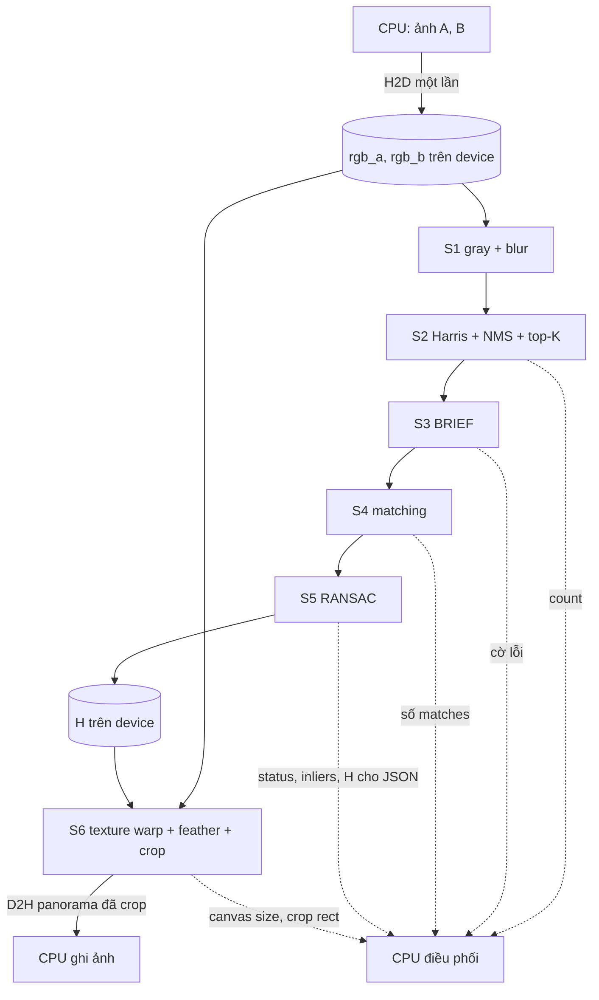

# V5 pipeline: Giữ dữ liệu trung gian trên GPU

Owner: Thụ. Theo [PLAN.md](../PLAN.md): V5 **chỉ đổi đường đi dữ liệu**, giữ nguyên
thuật toán, kernel, tham số và cách đo của version liền trước; đo H2D/D2H, end-to-end
và **số byte copy trước/sau**.

## 1. Nền code và giới hạn hiện tại

PLAN đặt V5 kế thừa V4. Tại thời điểm viết, V2 (S4 tiling) và V4 (blur tiling) chưa
được tích hợp, nên V5 được xây trên **version mới nhất đã ghép là V3** (kernel V1 cho
S1–S5 và kernel texture V3 cho S6). PLAN cho phép làm song song từ V1 + thiết kế
đường đi dữ liệu. Vì V5 dùng lại đúng các kernel đó, khi V2/V4 xong chỉ cần đổi
kernel trong các hàm `v5::*` tương ứng; cấu trúc dữ liệu thường trú trên device
không đổi. Khi đó phải chạy lại correctness và timing trước khi chốt V5.

So sánh hợp lệ của V5 là **V3 → V5** (cùng kernel, chỉ khác đường đi dữ liệu).
Bảng speedup phải ghi rõ điều này cho đến khi V4 có.

## 2. Thay đổi so với V3

| Dữ liệu | V1/V3 | V5 |
|---|---|---|
| Ảnh RGB A, B | H2D ở S1, **H2D lại** ở S6 | H2D **một lần** ở S1, S6 đọc lại buffer đó (texture bind trực tiếp) |
| Gray, blurred, Harris response (float) | D2H sau mỗi stage rồi H2D lại cho stage sau | Ở lại device |
| Keypoints top-K | D2H sau S2, H2D lại cho S3 và S5 | Ở lại device (copy device-to-device từ buffer sort sang buffer keypoint) |
| Descriptors | D2H sau S3, H2D lại cho S4 | Ở lại device |
| Matches | D2H sau S4, H2D lại cho S5 | Ở lại device |
| Homography | D2H sau S5, truyền lại cho S6 | Ở lại device; kernel chuẩn bị canvas đọc H từ device |

Các copy D2H còn lại đều là **metadata điều phối** hoặc **output**: số ứng viên NMS
(để launch merge sort), cờ keypoint lỗi của S3, số matches, kết quả S5 (status, số
inlier và H để ghi JSON), `CanvasConfig` (để cấp phát canvas), crop rectangle và
panorama cuối. H2D chỉ còn hai ảnh đầu vào.

Không đổi: mọi kernel, launch geometry, thứ tự launch, tham số, seed/dãy mẫu RANSAC,
tie-break, công thức bilinear/feather/crop, `--fmad=false`. Mỗi stage vẫn đồng bộ như
V1. Buffer scratch (tmp, Ixx/Iyy/Ixy) được dùng chung cho A và B vì nội dung đã hết
dùng sau mỗi lần gọi; việc này không đổi phép tính.

## 3. File

| File | Vai trò |
|---|---|
| [v5_stages.h](../../src/core_headers/v5_stages.h) | Interface device-pointer của S1–S6 cho V5 |
| [v5_pipeline.cu](../../src/cuda/v5_pipeline.cu) | `run_v5`, cấp phát workspace device, đo thời gian, `cuda_selftest_v5` |
| `v1_stage12.cu`, `v1_stage34.cu`, `v1_stage5.cu` | Thêm khối `namespace v5` ở cuối file, gọi **chính các kernel V1** trong cùng file; hàm V1 cũ không đổi |
| `v3_stage6.cu` | Thêm `v5::warp_blend` và `prepare_canvas_device_h_kernel` (giống `prepare_canvas_kernel`, chỉ đọc H từ device) |
| `common.h`, `cuda_utils.cuh` | Thêm `h2d_bytes`, `d2h_bytes` vào `StageTimes`; `v1_cuda::copy` cộng số byte. Áp dụng cho mọi version CUDA nên có số "trước" (V1/V3) để so với V5 |
| `report_io.h`, `main.cpp`, `versions.h` | `--version 5`, `--selftest --version 5`, JSON có `transfer_bytes` |
| [test_v5_pipeline.cpp](../../src/tools/v5/test_v5_pipeline.cpp) | Test V5 so với V0 (tiêu chí PLAN) và V3 (bit-exact), kiểm tra số byte |

## 4. Luồng V5



## 5. Timing và số byte

Cách đo giữ nguyên V1: các trường stage là tổng CUDA-event của kernel, `h2d`/`d2h` là
CUDA-event quanh `cudaMemcpy`, `end_to_end` là `steady_clock` gồm cấp phát, launch,
đồng bộ và copy. Thêm:

- `transfer_bytes.h2d`, `transfer_bytes.d2h` trong JSON (trung bình qua các lần đo), và dòng
  `avg_bytes h2d=... d2h=...` trên stdout.
- Copy device-to-device của top-K (≤ 3000 keypoint, ≤ 36 KB mỗi ảnh) không phải H2D/D2H nên
  không nằm trong hai trường trên; nó nằm trong `end_to_end`.
- Copy keypoint/match phục vụ `--debug-prefix` chạy ngoài phần đo, không được tính.

Ước lượng với ảnh P pixel mỗi ảnh (số thật lấy từ output test/CLI):

- V3 H2D ≈ 2 × (3P ảnh RGB ở S1 + 16P float cho blur/Harris/NMS/BRIEF + 3P ảnh RGB ở S6) ≈ 44P byte, cộng keypoints/descriptors/matches.
- V5 H2D = 2 × 3P = 6P byte (đúng bằng hai ảnh đầu vào; test kiểm tra điều này).
- V3 D2H ≈ 2 × 12P float (gray, blur, response) + keypoints/descriptors/matches + panorama.
- V5 D2H ≈ panorama + vài chục byte metadata.

Với 720p (P = 921.600) H2D giảm từ khoảng 40 MB xuống 5,5 MB. Tốc độ end-to-end thực tế
phải đo trên GPU; V5 có thể không nhanh hơn nhiều nếu copy không chiếm tỷ lệ lớn.
Khi đó vẫn giữ V5 và giải thích bằng số liệu, theo PLAN.

## 6. Build và chạy trên Colab GPU

```bash
nvcc -O2 -std=c++17 --fmad=false \
  -DPANORAMA_WITH_CUDA -DPANORAMA_WITH_V3 -DPANORAMA_WITH_V5 \
  -Isrc/core_headers -Isrc/libraries \
  src/integration/main.cpp src/integration/v0_pipeline.cpp \
  src/stage_implementations/v0_stage12.cpp src/stage_implementations/v0_stage34.cpp \
  src/stage_implementations/v0_stage5.cpp src/stage_implementations/v0_stage6.cpp \
  src/stage_implementations/v1_stage12.cu src/stage_implementations/v1_stage34.cu \
  src/stage_implementations/v1_stage5.cu src/stage_implementations/v1_stage6.cu \
  src/stage_implementations/v3_stage6.cu \
  src/cuda/cuda_pipeline.cu src/cuda/v3_pipeline.cu src/cuda/v5_pipeline.cu \
  src/libraries/stb_impl.cpp -o build/stitch_cuda

build/stitch_cuda --selftest --version 5
build/stitch_cuda dataset/location1/small_720p/1.jpg dataset/location1/small_720p/2.jpg \
  out/panorama_v5_location1_720p.png --version 5 --runs 5 --json reports/v5_location1_720p.json
```

Test đầy đủ (thay `main.cpp` bằng file test):

```bash
nvcc -O2 -std=c++17 --fmad=false \
  -DPANORAMA_WITH_CUDA -DPANORAMA_WITH_V3 -DPANORAMA_WITH_V5 \
  -Isrc/core_headers -Isrc/libraries \
  src/tools/v5/test_v5_pipeline.cpp src/integration/v0_pipeline.cpp \
  src/stage_implementations/v0_stage12.cpp src/stage_implementations/v0_stage34.cpp \
  src/stage_implementations/v0_stage5.cpp src/stage_implementations/v0_stage6.cpp \
  src/stage_implementations/v1_stage12.cu src/stage_implementations/v1_stage34.cu \
  src/stage_implementations/v1_stage5.cu src/stage_implementations/v1_stage6.cu \
  src/stage_implementations/v3_stage6.cu \
  src/cuda/cuda_pipeline.cu src/cuda/v3_pipeline.cu src/cuda/v5_pipeline.cu \
  src/libraries/stb_impl.cpp -o build/test_v5_pipeline

build/test_v5_pipeline                     # synthetic + ca lỗi
build/test_v5_pipeline dataset/location1/small_720p/1.jpg dataset/location1/small_720p/2.jpg
compute-sanitizer --error-exitcode 1 build/test_v5_pipeline
```

Chạy test với ảnh thật cho đủ 12 case (3 location + challenge, 3 độ phân giải), cùng
GPU session với V0/V1/V3, rồi lấy bảng V3 vs V5: `h2d`, `d2h`, `transfer_bytes`,
`kernel_total`, `end_to_end`. Theo PLAN, cần kèm output Nsight Systems cho thấy phần
copy trước (V3) và sau (V5).

## 7. Trạng thái kiểm chứng

- Đã kiểm tra cú pháp host và device bằng clang CUDA (header CUDA 12.9) cho mọi file
  thay đổi, cả với và không có `PANORAMA_WITH_V5`, và bản CPU `g++` của `main.cpp`.
  Lỗi duy nhất của clang là `cudaConfigureCall` ở mọi lệnh launch, kể cả code V1 gốc:
  đây là giới hạn của clang 18 với CUDA 12.9, không liên quan code.
- **Chưa build bằng nvcc và chưa chạy trên GPU** (máy làm việc không có nvcc/GPU).
  Chưa có kết quả correctness, sanitizer hay timing. V5 chỉ được chốt khi
  `test_v5_pipeline` PASS trên Colab cho đủ 12 case.
